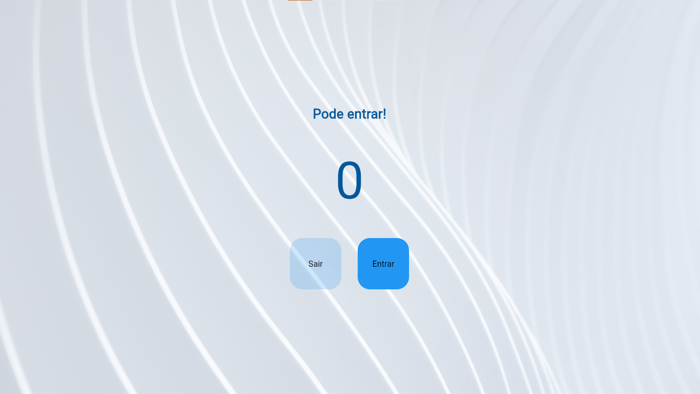

# Contador de Pessoas

Um aplicativo mobile desenvolvido com **Flutter** e **Dart** para gerenciar a quantidade de pessoas em um ambiente, com controle de entrada, saída e limite de capacidade.

\

&#x20; \
\

## Sobre o projeto

Este projeto foi desenvolvido como atividade prática da disciplina de **PAM**, com o objetivo de colocar em prática os conceitos iniciais de desenvolvimento de aplicativos utilizando Flutter e Dart.

O aplicativo permite acompanhar a quantidade de pessoas em um ambiente por meio de uma interface simples e intuitiva.

## Funcionalidades

- **Entrada de pessoas:** adiciona uma pessoa ao contador.
- **Saída de pessoas:** remove uma pessoa do contador.
- **Contador em tempo real:** exibe a quantidade atual de pessoas no ambiente.
- **Controle de capacidade:** estabelece o limite máximo de 15 pessoas.
- **Aviso de lotação:** informa quando o ambiente atinge sua capacidade máxima.

## Tecnologias utilizadas

| Tecnologia                      | Descrição                                                          |
| ------------------------------- | ------------------------------------------------------------------ |
| [Flutter](https://flutter.dev/) | Framework utilizado para desenvolver a interface do aplicativo.    |
| [Dart](https://dart.dev/)       | Linguagem utilizada para implementar a lógica do programa.         |
| [GitHub](https://github.com/)   | Plataforma utilizada para armazenar e compartilhar o código-fonte. |

## Integrantes

- **Alexsandro Damasceno dos Santos**
- **Felipe Valença de Oliveira**

O projeto foi desenvolvido no contexto de uma atividade em dupla e publicado no repositório GitHub de Alexsandro Damasceno dos Santos. Os commits e o histórico de alterações estão registrados nessa conta.

## Aprendizados

Este foi meu primeiro trabalho utilizando Flutter e Dart. Durante o desenvolvimento, pude praticar conceitos fundamentais da programação mobile, como:

- Criação de interfaces com componentes visuais.
- Utilização de botões para executar ações.
- Manipulação e atualização de variáveis.
- Uso de condições para controlar a capacidade do ambiente.
- Exibição de mensagens de acordo com o estado do aplicativo.

## Status do projeto

**Concluído** , atividade prática introdutória da disciplina de Programação Mobile.

---

Desenvolvido para a disciplina de **PAM**.